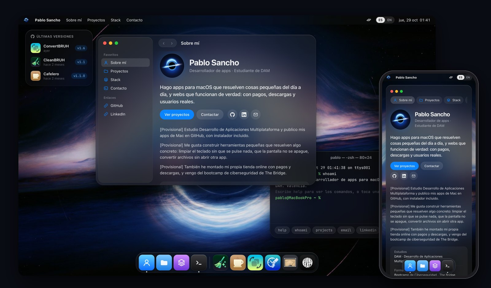
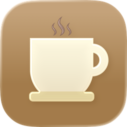
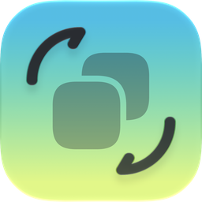
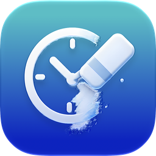
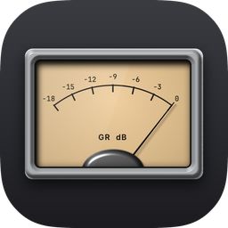

<div align="center">


# Pablo Sancho · Portfolio

**Mi web de desarrollador, hecha como un escritorio de macOS.**

[](https://pablosanchodev.vercel.app)


[🇬🇧 English version](./README.en.md)

</div>

<br />

<p align="center">
  
</p>

En vez de una página con scroll, la web es un escritorio de Mac: cada sección es una ventana.
**Sobre mí**, **Proyectos** y **Stack** están en un Finder, y **Contacto** es una Terminal en
la que se puede escribir de verdad. Está hecha solo con HTML, CSS y JavaScript, sin
frameworks ni librerías.

## Qué tiene

- 🪟 **Ventanas de macOS:** se arrastran, se traen al frente, se amplían con doble clic y se minimizan volando hasta su icono del Dock.
- 📁 **Un Finder de verdad:** la barra lateral cambia de sección dentro de la misma ventana y las flechas ‹ › van atrás y adelante.
- ⌨️ **Terminal de contacto:** entiende `help`, `whoami`, `projects`, `email` (y lo copia), `linkedin`, `open stack`, `lang en`… con historial (↑ ↓) y autocompletado (Tab). Debajo hay sugerencias para quien no quiera escribir.
- 🧲 **Dock** con efecto lupa al pasar el ratón y rebote al abrir una ventana.
- 📦 **Widget "Últimas versiones":** lee en directo de la API de GitHub la última release de cada app.
- 📱 **Móvil:** las ventanas se apilan, el Dock sirve para moverse y la ficha de cada proyecto sube desde abajo.
- 🌍 **Español e inglés:** elige según el idioma del navegador y se puede cambiar desde la barra de menú.
- ♿ **Accesible:** se puede usar con teclado, los botones tienen nombre para lectores de pantalla y respeta "Reducir movimiento".

## Proyectos que aparecen

| | Proyecto | Qué es |
|---|---|---|
|  | [CleanBRUH](https://github.com/pablo96sancho/CleanBRUH) | Bloquea teclado, ratón y trackpad para limpiar el Mac |
|  | [Cafelero](https://github.com/pablo96sancho/Cafelero) | Mantiene la pantalla del Mac encendida |
|  | [ConvertBRUH](https://github.com/pablo96sancho/ConvertBRUH) | Convierte archivos desde el Finder |
|  | UnRecent | Quita archivos de Recientes sin borrarlos · *próximamente* |
|  | Djoko_vox | Plugin de audio para grabar voces (C++, JUCE) · *próximamente* |
|  | Tienda online | Pagos con Stripe, archivos en Cloudflare R2 y descargas firmadas |

## Cómo está hecha

```
index.html          barra de menú, escritorio con las ventanas y Dock
css/                base · desktop · window · sections · terminal · mobile
js/
  i18n.js           todos los textos en español e inglés
  data.js           proyectos y stack (añadir uno = añadir un objeto)
  render.js         pinta el contenido a partir de data.js
  windows.js        abrir, cerrar, minimizar, ampliar y arrastrar ventanas
  finder.js         paneles del Finder e historial ‹ ›
  dock.js           efecto lupa y rebote
  terminal.js       la terminal y sus comandos
  widget.js         últimas versiones desde la API de GitHub
  main.js           arranque
tools/
  render_logo.py    genera el logo del agujero negro (numpy + Pillow)
```

Algunas cosas que usa: `backdrop-filter` para el cristal de las ventanas, la Web Animations
API para abrir y minimizar, máscaras CSS para pintar cada logo del color de su marca,
`Intl` para fechas y horas en cada idioma, y `IntersectionObserver` para que la terminal
arranque cuando se ve.

## Probarla en local

```bash
git clone https://github.com/pablo96sancho/PabloSanchoDev_Portfolio.git
cd PabloSanchoDev_Portfolio
python3 -m http.server 8000
```

Y abrir <http://localhost:8000>. Hace falta un servidor: abriendo `index.html` directamente,
el navegador bloquea las máscaras de los logos.

## El logo

Es un agujero negro tipo Gargantua (*Interstellar*): el disco cruza por delante y su parte
trasera se ve curvada por encima y por debajo por la gravedad. No está dibujado a mano, se
renderiza con [`tools/render_logo.py`](tools/render_logo.py):

```bash
pip3 install numpy pillow
python3 tools/render_logo.py
```

## Créditos

- Logos de tecnologías: [Simple Icons](https://simpleicons.org) (CC0).

---

<div align="center">

Hecho por **Pablo Sancho** en Valencia ·
[LinkedIn](https://www.linkedin.com/in/pablo-sancho-alegre/) ·
[GitHub](https://github.com/pablo96sancho)

</div>
